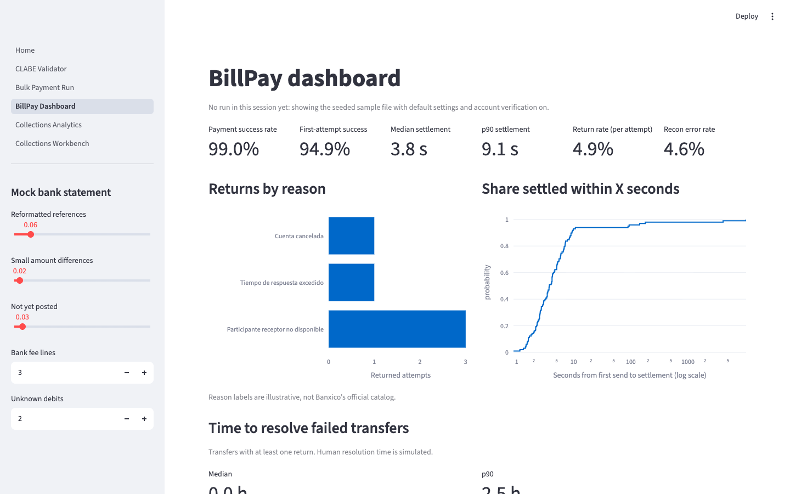
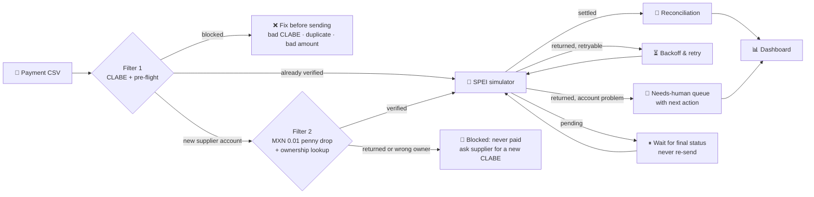
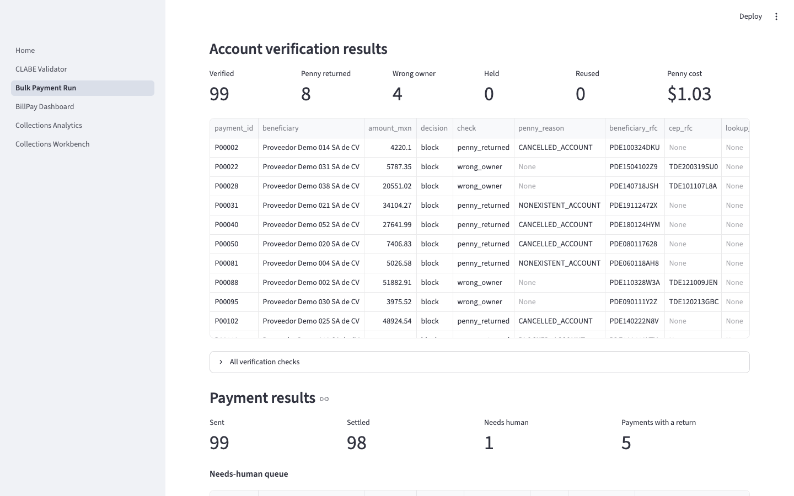
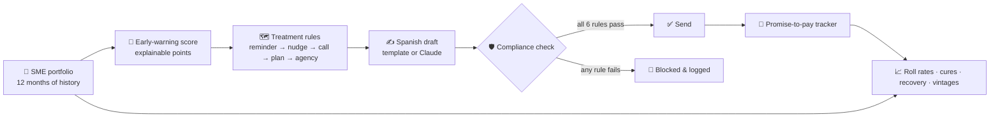
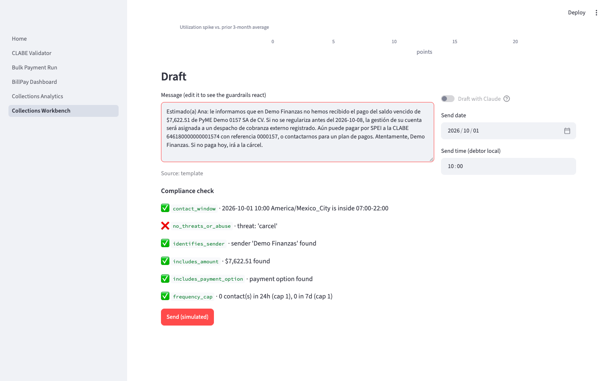
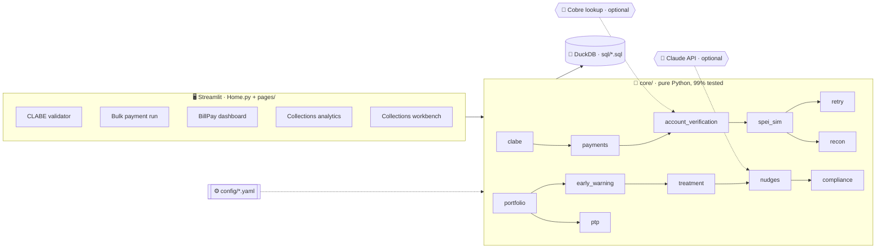

<div align="center">

# 💸 mx-payments-ops-lab

### What happens *after* a Mexican SME hits "pay" or "collect", and how to make it boring.

A hands-on lab for two problems every LatAm spend-management fintech eventually owns:<br>
**getting supplier payments over SPEI to land**, and **collecting from B2B customers without crossing the line**.

[](https://github.com/manuel-lomelin/mx-payments-ops-lab/actions/workflows/ci.yml)


[**What's new**](#-whats-new) · [**What it does**](#-what-the-lab-does) · [**Why it matters**](#-who-it-helps-and-how) · [**Why it's built this way**](#-why-its-built-this-way) · [**Run it**](#-run-it-in-two-commands) · [**Product docs**](#-product-thinking-not-just-code)



</div>

---

## 🆕 What's new

| | Change | What it means |
|---|---|---|
| 🪙 | **Filter 2: penny drop + ownership lookup** ([#22](https://github.com/manuel-lomelin/mx-payments-ops-lab/pull/22)) | Every new supplier account gets a MXN 0.01 SPEI transfer before its first real payment. A return blocks it; a settled cent's CEP must show the invoice RFC. A Cobre-style lookup cross-checks the owner without moving money. On the sample file: **12 bad accounts stopped before any real money moved**, sent-payment success **94.6% → 99.0%**, for **MXN 1.03** |
| 🏦 | **99-institution bank catalog** ([#21](https://github.com/manuel-lomelin/mx-payments-ops-lab/pull/21)) | Filter 1 now knows every code in the Spanish Wikipedia [CLABE table](https://es.wikipedia.org/wiki/CLABE) (banks, development banks, brokerages, STP, Nvio, Mercado Pago), up from 22 |
| 🔌 | **Live Cobre client** | Set `COBRE_USER_ID` / `COBRE_SECRET` to run the ownership lookup against [Cobre's Account Verification API](https://docs.cobre.com/account-verification-1886570m0.md) instead of the simulator |
| 📐 | **[ADR 0005](docs/decisions/0005-two-filter-account-validation.md)** | Why the penny drop is the primary check and the lookup is the cross-check |
| 🧪 | **207 tests**, 99% coverage on `core/` | Every filter-2 decision path, the cache, response windows, and the Cobre client against a fake server |

Next up: a real penny drop through the provider with CEP retrieval ([#23](https://github.com/manuel-lomelin/mx-payments-ops-lab/issues/23)) and a bank catalog sourced from Banxico ([#24](https://github.com/manuel-lomelin/mx-payments-ops-lab/issues/24)).

---

## 🧭 The problem in one minute

**Paying suppliers.** A finance analyst uploads a file with 120 supplier payments. One CLABE
has a typo, two rows are duplicates, a receiving bank times out at 10:02, and the statement
prints references differently from what was sent. None of that is hard. All of it is manual.
And a perfectly valid CLABE can still be dead, or belong to someone else: the classic "we
changed banks, pay this new account" email. The worst outcomes aren't failed payments,
they're **paying the same supplier twice, or paying the wrong account once**.

**Collecting from customers.** A lender has 400 SME credit lines. Some customers are a few
days late and will pay with a friendly WhatsApp; others are sliding toward 90+ days. Agents
work from a spreadsheet, every account gets the same message, and sooner or later someone
sends a text at 11 pm that hints at "legal consequences". That's a **CONDUSEF complaint
waiting to happen**.

This lab turns both workflows into something you can click through, measure, and argue about.

---

## 🔬 What the lab does

### Module 1 · SPEI BillPay Ops



| Step | What you see | Why it matters |
|---|---|---|
| **Filter 1 · CLABE validator** | 18 digits split into bank / plaza / account / check digit, verified with the 3-7-1 weights against a 99-institution catalog (from the [CLABE article](https://es.wikipedia.org/wiki/CLABE)) | The cheapest failure to prevent is the one caught before sending |
| **Filter 1 · Pre-flight report** | Every row marked *ready*, *warning* or *blocked*, with the reason | The analyst fixes 9 rows instead of chasing 9 returns |
| **Filter 2 · Penny drop** | New supplier accounts get MXN 0.01 over SPEI first. A return blocks the account; a settled cent's CEP must show the invoice RFC | A dead account fails on one cent, not on a $250,000 invoice, and **a CLABE that isn't the supplier's never gets paid** |
| **Filter 2 · Ownership lookup** | A no-money cross-check that the CLABE belongs to that RFC, modelled on [Cobre's Account Verification API](https://docs.cobre.com/account-verification-1886570m0.md) (simulated by default, live client included) | A second, independent owner check; disagreement holds the payment for review |
| **SPEI simulator** | Settled / returned (devolución) / pending, realistic latency, tunable odds | Lets you stress-test ops flows without a bank |
| **Retry policy** | Infra failures retried with backoff; account failures routed to a human with a suggested fix | Fewer manual re-sends, **zero double payments by design** |
| **Reconciliation** | Exact match → fuzzy match → unmatched *both ways* (sent-not-posted and posted-not-sent) | Month-end close becomes an exception list, not a spreadsheet hunt |
| **Dashboard** | Success rate, median/p90 settlement, returns by reason, recon error rate, time to resolve | Ops gets the same numbers the CFO asks for |

<div align="center">

<br><sub>Filter 2 on the sample file: 8 accounts returned the penny and 4 belonged to a different RFC
(compare <code>beneficiary_rfc</code> with <code>cep_rfc</code>). None of them got a real payment.</sub>
</div>

### Module 2 · Collections Workbench



| Step | What you see | Why it matters |
|---|---|---|
| **Delinquency analytics** | DPD buckets, roll-rate matrix, cure and recovery rates, days to resolution, vintage curves, all in plain SQL shown next to each chart | The metrics a collections strategy is judged by, readable by any analyst |
| **Early-warning score** | 0-100 points from 5 behaviours (utilization spike, partial/missed payments, broken promises, DPD), with a bar chart of *why* | Agents trust what they can explain; auditors too |
| **Treatment engine** | First-match rules by bucket, segment and risk, editable in YAML | Strategy changes are a config diff, not a deploy |
| **Nudge drafter** | A Spanish WhatsApp/email/call script per account and stage | Faster, more personal outreach |
| **Compliance guardrails** | ✅/❌ per rule: contact window in the debtor's timezone, no threats or abuse, sender named, exact amount, payment option, frequency caps | **No message leaves without passing**, whoever or whatever wrote it |
| **Promise-to-pay tracker** | Record promises, see kept vs. broken by bucket and month | Tells you which promises are worth believing |

<div align="center">

<br><sub>Type a threat into any draft and watch it get blocked: <code>no_threats_or_abuse · threat: 'carcel'</code></sub>
</div>

---

## 🎯 Who it helps and how

| Persona | Pain today | What the lab gives them |
|---|---|---|
| 🧾 **Finance ops analyst** | Chasing returns and re-sending by hand | Pre-flight before sending, auto-retry for infra failures, a short queue with the next step written out |
| 🏦 **Treasury / AP lead** | Fear of double payments, "we changed banks" fraud, slow month-end close | Accounts proven with a penny before the first payment, a retry policy that never re-sends pending transfers, reconciliation that surfaces only real exceptions |
| 📞 **Collections agent** | Same script for everyone, unsure what's allowed | A prioritized worklist, the reason each account is risky, a compliant draft ready to send |
| 📋 **Collections manager** | Strategy lives in someone's head | Roll rates and cures to steer by, treatment rules in one YAML file |
| 📊 **CFO** | Can't see where cash gets stuck | Success, settlement time, recovery and vintage curves, with the SQL behind every number |
| ⚖️ **Compliance** | Hopes agents behave | Deterministic rules, a block log, and an LLM that can't bypass either |

### What the seeded demo shows

> These numbers come from synthetic data with fixed seeds. They show that the mechanics work,
> not how any real bank or portfolio performs.

**BillPay run, 120-row supplier file.** Filter 1 blocks 9 rows (4 short CLABEs, 3 duplicates,
1 wrong check digit, 1 non-positive amount). Then, with and without filter 2:

| | Filter 1 only | Filter 1 + filter 2 |
|---|---|---|
| Payments sent | 111 | **99** (12 accounts stopped before any real money moved) |
| Stopped by a returned penny / wrong owner | – | **8 / 4** |
| Sent payments that settled | 94.6% | **99.0%** |
| Payments needing a human after sending | 6 | **1** |
| Reconciliation error rate | 5.2% | **4.6%** |
| Cost of verification | – | **MXN 1.03** in pennies, 99 lookups (median ~10 min) |
| Second run of the same file | – | **0** new pennies: all 99 verified accounts reused |

Median settlement is 3.7 s either way (p90 8.8 s without filter 2, 9.1 s with it).

**Collections portfolio, 400 SMEs**

| Accounts with DPD > 0 | 1-30 DPD that cure next month | Recovery on 90+ exposure | Next-month roll rate, low → high risk band | Promises to pay kept |
|---|---|---|---|---|
| **23%** | **80%** | **33%** | **15% → 36% → 83%** | **79%** |

---

## 🏗 Why it's built this way

Every choice below is a product decision first and a technical one second. The long form is
in the [ADRs](docs/decisions/).

<table>
<tr>
<td width="50%" valign="top">

**🧱 Rules decide, the LLM only writes**<br>
Whether and when to contact someone is a deterministic rule. Claude helps with *wording*, and
its output goes through the same six checks as a template. With no API key the app still
does everything. → [ADR 0003](docs/decisions/0003-rules-plus-llm.md)

</td>
<td width="50%" valign="top">

**🔁 Never re-send a pending transfer**<br>
Retry only what's retryable (receiving bank down, timeout) and wait on anything still in
flight. The tests assert that no retry starts before the previous attempt resolved.
→ [ADR 0002](docs/decisions/0002-retry-policy.md)

</td>
</tr>
<tr>
<td valign="top">

**🧮 Explainable over clever**<br>
The risk score is a points table, not a model. Every point traces to one behaviour, and a
T-1 → T backtest checks that higher bands really roll more.

</td>
<td valign="top">

**🦆 SQL as the contract (DuckDB)**<br>
Roll rates, cures and KPIs are plain `.sql` files that run in-process, in tests, in the app
and in the DuckDB CLI. No servers, and an analyst can review every number.
→ [ADR 0001](docs/decisions/0001-duckdb-for-storage-and-analytics.md)

</td>
</tr>
<tr>
<td valign="top">

**⚙️ Business rules in YAML**<br>
Return reasons, retry limits, score weights, treatment stages, compliance patterns and
message templates all live in [`config/`](config/). Ops can tune them without touching code.

</td>
<td valign="top">

**🧪 Honest by construction**<br>
100% synthetic, seeded data ([ADR 0004](docs/decisions/0004-synthetic-data-and-illustrative-codes.md)).
SPEI return reasons are labelled illustrative. Every number in this README comes from the
seeded demo and can be reproduced with the default seeds.

</td>
</tr>
<tr>
<td valign="top">

**🪙 Prove the account before paying it**<br>
A valid CLABE can still be dead or someone else's. New supplier accounts get a MXN 0.01
penny drop (does it settle? does the CEP show the invoice RFC?) plus an ownership lookup.
Verified pairs are reused, so each account costs one cent once.
→ [ADR 0005](docs/decisions/0005-two-filter-account-validation.md)

</td>
<td valign="top">

**🧾 Cheap checks first, paid checks second**<br>
Filter 1 is offline and free, so it runs on every row and keeps bad rows from ever
costing a penny or a lookup. Filter 2 only runs on rows that pass it, and only once per
new (CLABE, RFC) pair.

</td>
</tr>
</table>

### Architecture



`core/` never imports Streamlit, so the domain logic is tested on its own. The UI is a
thin layer over it.

---

## 🚀 Run it in two commands

```bash
git clone https://github.com/manuel-lomelin/mx-payments-ops-lab.git && cd mx-payments-ops-lab
make setup && make run
```

Then open http://localhost:8501. Requires Python 3.11+.

**Suggested 3-minute tour**
1. **Bulk Payment Run**: review the filter-1 report, then hit *Verify and send*. See which accounts filter 2 stopped and why (compare `beneficiary_rfc` with `cep_rfc`). Send again: verified accounts are reused, no new pennies.
2. **BillPay Dashboard**: drag the bank-statement noise sliders and watch reconciliation react.
3. **Collections Analytics**: read the roll-rate matrix, then open any *SQL* expander.
4. **Collections Workbench**: pick an account, see why it's risky, then add *"irá a la cárcel"* to the draft. It gets blocked.

<details>
<summary><b>More commands and the optional LLM</b></summary>

| Command | Does |
|---|---|
| `make test` | Run the test suite |
| `make cov` | Tests with coverage on `/core` (CI gate: 80%) |
| `make lint` | Ruff lint + format check |
| `make seed` | Rewrite `data/sample_payments.csv` and build `data/lab.duckdb` for ad-hoc SQL |

Try the SQL directly: `duckdb data/lab.duckdb < sql/roll_rates.sql`

**Optional live Cobre lookup:** set `COBRE_USER_ID` and `COBRE_SECRET` (and `COBRE_BASE_URL`
for a sandbox) to use Cobre's Account Verification API as the ownership lookup instead of the
simulator. The client follows Cobre's public docs; it has not been run against the live API
from this repo. The penny drop itself always runs on the SPEI simulator.

**Optional Claude drafting:** copy `.env.example` to `.env` (or export the variables) and set
`ANTHROPIC_API_KEY`. Drafts then use `claude-opus-5-5` (override with `ANTHROPIC_MODEL`) with
the API's server-side refusal fallback enabled. Without a key, deterministic Spanish
templates are used, and LLM drafts go through the same compliance checks.

</details>

---

## 🧠 Product thinking, not just code

| Doc | What's in it |
|---|---|
| [One-pager · BillPay](docs/one-pager-billpay.md) | Problem, users, hypotheses, north-star and guardrail metrics, 30/60/90 days, SAT/CNBV/PLD risks, what I didn't build |
| [One-pager · Collections](docs/one-pager-collections.md) | Same structure for the collections workbench |
| [Experiment design](docs/experiments.md) | A/B test for the nudge: unit, primary metric, MDE with the sample-size math, stop rules |
| [Compliance notes](docs/compliance-notes.md) | The reasoning behind each guardrail and what pattern checks can't catch |
| [Decisions (ADRs)](docs/decisions/) | DuckDB · retry policy · rules + LLM · synthetic data · two-filter account validation |
| [Roadmap](docs/roadmap.md) | The backlog, also tracked as GitHub Issues |

<details>
<summary><b>📖 Metrics glossary</b></summary>

| Metric | Definition |
|---|---|
| Payment success rate | Payments that end settled ÷ payments sent (after retries) |
| First-attempt success | Payments settled on attempt 1 ÷ payments sent |
| Settlement time | First send → settlement, settled payments only (median, p90) |
| Return rate (per attempt) | Returned attempts ÷ all attempts; by reason in the dashboard |
| Time to resolve failed transfers | First send → settled on retry or resolved by a human, for payments with ≥ 1 return |
| Recon error rate | (unmatched payments + unmatched statement lines + matches with an amount difference) ÷ (expected payments + statement lines − reversal-pair lines) |
| DPD bucket | current, 1-30, 31-60, 61-90, 90+ (plus charged-off at 180+ DPD) |
| Roll rate | Share of accounts in bucket X at month t that are in bucket Y at t+1 |
| Cure rate | Share of delinquent accounts at month t that are current at t+1 |
| Recovery rate | Cash collected after an account first hits 90+ ÷ balance at that point |
| Days to resolution | Missed due date → payment that made the account current (open episodes censored) |
| Vintage curve | Share of an origination cohort ever 30+ DPD by months on book |
| PTP kept rate | Promises where next payment ≥ 95% of the promised amount ÷ resolved promises |
| Risk score | Sum of feature points (0-100) from `config/early_warning.yaml` |

</details>

<details>
<summary><b>🗂 What's where</b></summary>

```
Home.py, pages/        Streamlit UI (5 pages)
core/                  Domain logic: clabe, payments, account_verification, spei_sim, retry,
                       recon, portfolio, early_warning, treatment, nudges, compliance, ptp
sql/                   Every metric as a plain DuckDB query
config/                Business rules in YAML
data/                  Bank catalog (from Wikipedia) + seeded sample payment file and bank registry
docs/                  One-pagers, ADRs, experiment design, compliance notes, roadmap
tests/                 Unit tests for core/ + smoke tests for every page
```

</details>

---

## 🤖 Built with AI coding tools

I built this with Claude Code as a pair programmer. I set the product scope, constraints and
acceptance criteria. The assistant prototyped each module on its own feature branch, and I
reviewed every diff. I challenged the domain calls (which returns are retryable, what counts
as a cure, what the guardrails must block) and asked for changes. One example: the first
draft of account verification wrapped Cobre's ownership lookup and called it a penny
validation. It isn't one, because no money moves. I redirected it to a real MXN 0.01 penny
drop with a CEP owner check as the primary proof, with the lookup as a cross-check. Tests and CI are the
contract: nothing merges without ruff, pytest and the coverage gate passing. Two real bugs
were caught that way and are documented in the PR history.

## ⚠️ Limitations and synthetic data

- **All data is synthetic** and seeded. Names are obviously fake ("PyME Demo 0042",
  "Demo Finanzas"); the only real names are public bank names in `data/banks.csv`, a subset
  to verify against Banxico.
- **SPEI return reasons are illustrative labels**, not Banxico's official catalog or codes.
- **The bank catalog comes from Wikipedia's CLABE article** and lags real changes: it has no
  entry for some current participants, and its own worked example uses a retired code (032).
  Verify against Banxico's participant list before production use.
- **Filter 2 is simulated**: the penny drop runs on the SPEI simulator against a synthetic
  bank registry, and the CEP is synthetic. The Cobre lookup client is untested against the
  live API.
- Settlement latency, human resolution time and the bank statement are simulated. The
  portfolio has no interest or fees, and balances freeze at 90+ DPD.
- **Compliance rules are a high-level reading of CONDUSEF's collection rules**, implemented
  as patterns. This is not legal advice; verify before any real use.
- No real SPEI, WhatsApp, email or dialer integrations. State lives in the browser session.
- **Live demo:** not deployed yet (tracked in the roadmap).

<div align="center">

**MIT licensed** · Built by [manuel-lomelin](https://github.com/manuel-lomelin) · Product Lead, Mexican fintech

</div>
