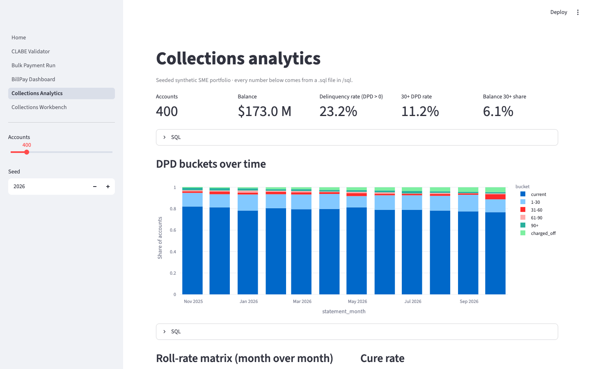
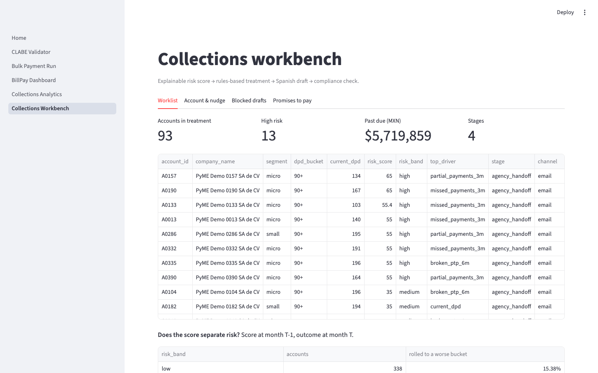
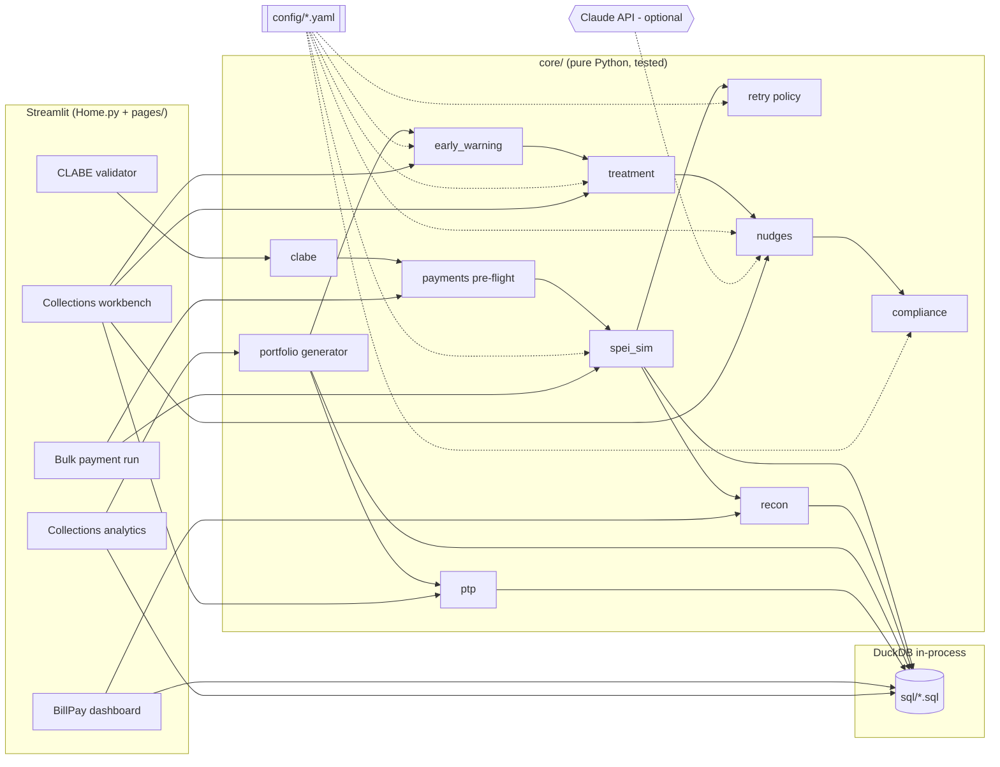

# mx-payments-ops-lab

**A working demo of two Mexican fintech problems, built by a Product Lead who codes:
SPEI bill-pay reliability and B2B collections.** Upload a supplier payment file and watch it
get pre-validated (CLABE check digit, duplicates, field limits), sent through a SPEI
simulator with returns and a retry policy that never double-pays, and reconciled against a
mock bank statement. Then switch to a seeded SME credit portfolio: roll rates, cures,
recoveries and vintages in plain SQL, an explainable early-warning score, rules-based
treatment, and a Spanish collection-message drafter where every draft (template or LLM) must
pass compliance guardrails before it can be sent.

> Synthetic data only. Numbers below come from the seeded demo and say nothing about any real
> bank, lender or portfolio.

**Live demo:** not deployed yet (tracked in the roadmap). Run it locally in two commands below.

| BillPay dashboard | Compliance guardrails catching a threat |
|---|---|
|  |  |
| **Collections analytics** | **Collections workbench** |
|  |  |

## What's inside

| Module | What it does | Code |
|---|---|---|
| CLABE validator | 18-digit structure, 3-7-1 check digit, bank catalog lookup | `core/clabe.py` |
| Bulk payment run | CSV upload, pre-flight report (CLABE, amount, duplicates, reference length) | `core/payments.py` |
| SPEI simulator | Settled / returned / pending with lognormal latency; illustrative return reasons | `core/spei_sim.py`, `config/spei_returns.yaml` |
| Retry policy | Retryable vs. not, exponential backoff, never re-send pending, needs-human queue | `core/retry.py`, `config/retry_policy.yaml` |
| Reconciliation | Reversal pairs → exact (reference + amount) → fuzzy; unmatched both ways | `core/recon.py` |
| BillPay dashboard | Success rate, median/p90 settlement, returns by reason, recon error, time to resolve | `sql/billpay_*.sql` |
| Portfolio generator | 400 SME accounts, 12 monthly statements, payments, promises; seeded | `core/portfolio.py` |
| Delinquency analytics | DPD buckets, roll-rate matrix, cure, recovery, days to resolution, vintages | `sql/*.sql` |
| Early-warning score | Points table with per-feature contributions and a T-1 → T backtest | `core/early_warning.py` |
| Treatment engine | Reminder → nudge → call → payment plan → agency, by bucket/segment/risk | `config/treatment.yaml` |
| Nudge drafter + guardrails | Spanish template or Claude draft; 6 compliance checks; blocked drafts logged | `core/nudges.py`, `core/compliance.py` |
| Promise-to-pay tracker | Record promises, kept/broken outcomes by bucket and month | `core/ptp.py`, `sql/ptp_*.sql` |

## Architecture



Business rules live in YAML (`config/`), analytics in SQL (`sql/`), logic in `core/`, and the
UI in `Home.py` + `pages/`. Nothing in `core/` imports Streamlit.

## Run locally

Requires Python 3.11+.

```bash
make setup && make run
```

Other targets: `make test`, `make cov` (coverage on `/core`, gate at 80%), `make lint`,
`make seed` (rewrites `data/sample_payments.csv` and builds `data/lab.duckdb` for ad-hoc SQL,
e.g. `duckdb data/lab.duckdb < sql/roll_rates.sql`).

Optional LLM drafting: copy `.env.example` to `.env` (or export the variables) and set
`ANTHROPIC_API_KEY`. Without it the app is fully functional and uses deterministic Spanish
templates. With it, drafts use `claude-opus-5-5` by default (override with
`ANTHROPIC_MODEL`), with the API's server-side refusal fallback enabled, and still go
through the same compliance checker.

## What the demo shows (seeded defaults)

- **Pre-flight:** 120-row sample file → 111 ready, 9 blocked (4 short CLABEs, 3 duplicates,
  1 wrong check digit, 1 non-positive amount).
- **SPEI run:** 94.6% settled (93.7% on first attempt), median settlement 3.7 s, p90 8.8 s;
  returned payments resolved in a median of 4.1 h (human time is simulated).
- **Reconciliation:** 92 exact + 8 fuzzy matches, 7 reversal pairs, 5.2% recon error rate.
- **Portfolio (as of 2026-09-30):** 400 accounts, 23% with DPD > 0, 11% at 30+ DPD;
  1-30 → current roll 80%, 1-30 → 31-60 roll 15%; recovery on 90+ exposure 33%.
- **Early-warning backtest:** next-month roll rate 15% / 36% / 83% for low / medium / high
  bands. This validates the mechanics on synthetic data, not real-world lift.
- **Promises to pay:** 79% kept among resolved promises.

## Metrics glossary

| Metric | Definition |
|---|---|
| Payment success rate | Payments that end settled ÷ payments sent (after retries) |
| First-attempt success | Payments settled on attempt 1 ÷ payments sent |
| Settlement time | First send → settlement, settled payments only (median, p90) |
| Return rate (per attempt) | Returned attempts ÷ all attempts; by reason in the dashboard |
| Time to resolve failed transfers | First send → settled on retry or resolved by a human, for payments with ≥ 1 return |
| Recon error rate | (unmatched payments + unmatched statement lines + matches with an amount difference) ÷ (expected payments + statement lines − reversal-pair lines) |
| DPD bucket | current, 1-30, 31-60, 61-90, 90+ (plus charged-off at 180+ DPD) |
| Roll rate | Share of accounts in bucket X at month t that are in bucket Y at t+1 |
| Cure rate | Share of delinquent accounts at month t that are current at t+1 |
| Recovery rate | Cash collected after an account first hits 90+ ÷ balance at that point |
| Days to resolution | Missed due date → payment that made the account current (open episodes censored) |
| Vintage curve | Share of an origination cohort ever 30+ DPD by months on book |
| PTP kept rate | Promises where next payment ≥ 95% of the promised amount ÷ resolved promises |
| Risk score | Sum of feature points (0-100) from `config/early_warning.yaml` |

## Product docs

- [One-pager: SPEI BillPay Ops](docs/one-pager-billpay.md)
- [One-pager: Collections Workbench](docs/one-pager-collections.md)
- [Experiment design: collections nudge A/B test](docs/experiments.md)
- [Compliance notes](docs/compliance-notes.md)
- Decisions: [DuckDB](docs/decisions/0001-duckdb-for-storage-and-analytics.md) ·
  [Retry policy](docs/decisions/0002-retry-policy.md) ·
  [Rules + LLM](docs/decisions/0003-rules-plus-llm.md) ·
  [Synthetic data](docs/decisions/0004-synthetic-data-and-illustrative-codes.md)
- [Roadmap](docs/roadmap.md)

## Built with AI coding tools

I built this with an AI coding assistant (Claude Code) as a pair. The workflow: I set the
product scope, constraints and acceptance criteria; the assistant prototyped each module
on a feature branch; I reviewed the diffs, questioned the edge cases and the domain choices
(which return reasons are retryable, what counts as a cure, what the guardrails must
block), and asked for changes. Tests and CI are the contract: nothing merges without ruff
and pytest passing and the coverage gate on `/core`. AI-generated code got the same review
as any teammate's.

## Limitations / synthetic data

- All data is synthetic and seeded. Company and person names are obviously fake; the only
  real names are public bank names in `data/banks.csv` (a subset; verify against Banxico).
- SPEI return reasons are **illustrative labels**, not Banxico's official catalog or codes.
- Settlement latency, human resolution time and the bank statement are simulated.
- The portfolio has no interest or fees, and balances freeze at 90+ DPD.
- Compliance rules are a high-level reading of CONDUSEF's collection rules, implemented as
  patterns. Not legal advice; verify before use. See `docs/compliance-notes.md`.
- No real SPEI, WhatsApp, email or dialer integrations. State lives in the browser session.

## License

MIT, see [LICENSE](LICENSE).
